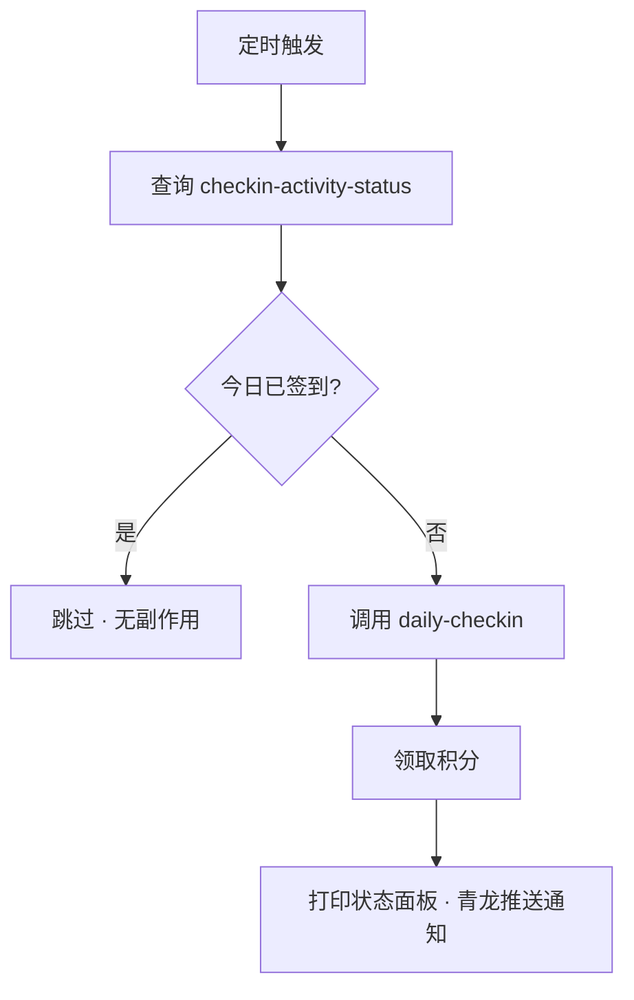
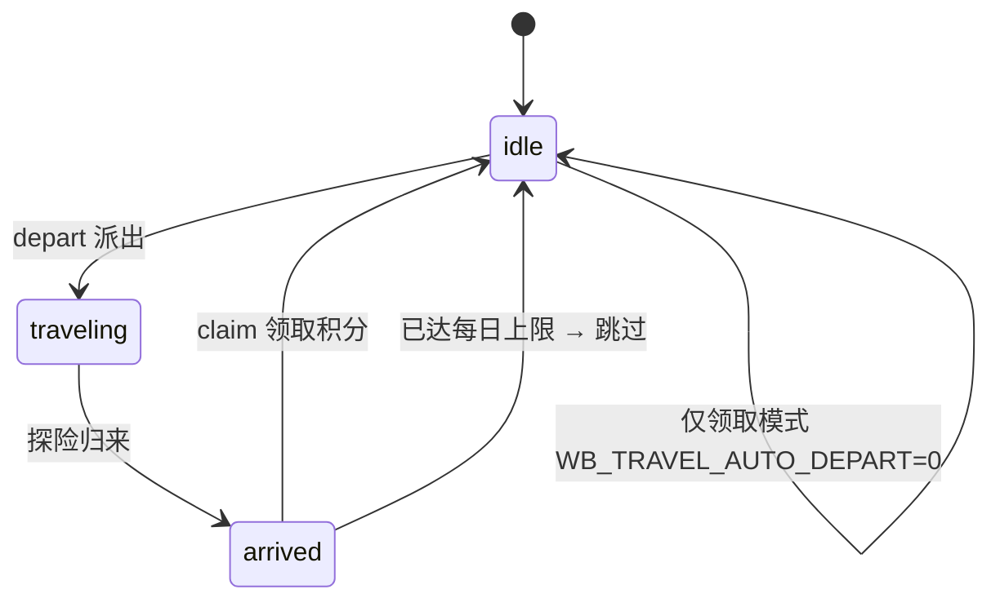
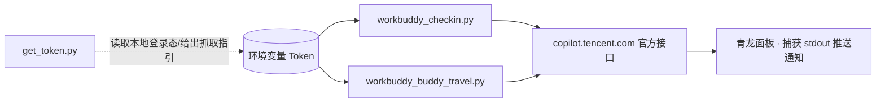

# WorkBuddy 自动化工具箱（青龙面板版） ⚡

> 把 WorkBuddy 的「每日签到」和「宠物自动探险领积分」两个高频手动操作完全自动化，纯 Python 跑在[青龙面板](https://github.com/whyour/qinglong)上定时执行。

[](https://github.com/xmgzxmgz/workbuddy-checkin-qinglong)
[](LICENSE)
[](https://github.com/whyour/qinglong)
[](https://www.python.org)
[](requirements.txt)

[🐱 一键订阅到青龙](#-安装) · [🐛 报 Issue](https://github.com/xmgzxmgz/workbuddy-checkin-qinglong/issues) · [💡 提需求](https://github.com/xmgzxmgz/workbuddy-checkin-qinglong/issues)

---

## 📑 目录
- [✨ 功能](#-功能)
- [💡 为什么用这个](#-为什么用这个)
- [🔧 安装](#-安装)
- [🚀 快速开始](#-快速开始)
- [📊 状态面板](#-状态面板)
- [🔀 工作流](#-工作流)
- [🏗️ 架构](#-架构)
- [🔐 获取 Token](#-获取-token)
- [🌿 环境变量](#-环境变量)
- [🗺️ 路线图](#-路线图)
- [❓ 常见问题](#-常见问题)
- [🙏 致谢](#-致谢)

## ✨ 功能

| 脚本 | 功能 | 状态 |
| --- | --- | --- |
| `workbuddy_checkin.py` | 每日自动签到，领取积分，输出完整签到状态面板 | ✅ 稳定 |
| `workbuddy_buddy_travel.py` | 宠物自动探险（派出）+ 归来自动领积分 | ✅ 稳定 |
| `get_token.py` | 自动定位登录态文件、提取 Token、校验有效性 | 🆕 5.8.3+ 适配 |

三个脚本共用同一套设计原则：

- **零重依赖**：仅需 `requests`（青龙一般已自带），缺失时自动回退标准库 `urllib`
- **Token 不写死**：全部从环境变量读取，支持多账号一行配置
- **幂等安全**：高频运行无副作用；已签到 / 宠物空闲时调用领取会被优雅跳过
- **失败自愈**：网络抖动与 5xx 自动退避重试，4xx 直接报出原因不空转
- **青龙友好**：输出直接被面板捕获并推送通知（Server 酱 / 钉钉 / 企业微信 / Telegram）

> ⚠️ 本工具仅向官方接口 `copilot.tencent.com` 发送**你自己的** Bearer Token，不会上传到任何第三方。**Token 属于敏感凭证，请勿提交到公开仓库、也不要在公开场合泄露。** 登录态通常约 90 天有效，且可能被服务端提前吊销，过期后需重新获取并更新环境变量。

## 💡 为什么用这个

| 能力 | 本工具 | 手动操作 | 其它签到脚本 |
| --- | --- | --- | --- |
| 每日签到 | ✅ 自动 | ❌ 易忘 | ✅ |
| 宠物探险 + 领积分 | ✅ 全自动 | ❌ 需手动领 | ⚠️ 少见 |
| 签到状态面板（连续天数 / 奖励进度 / 打卡日历） | ✅ | ⚠️ 要点开客户端看 | ❌ |
| Token 提取助手（含新版加密格式诊断） | ✅ `get_token.py` | ❌ | ❌ |
| 多账号一行配置 | ✅ | ❌ | ⚠️ 各异 |
| 幂等可高频跑 | ✅ | — | ⚠️ |
| 零重依赖 | ✅ requests/urllib | — | ❌ 常带重依赖 |

## 🔧 安装

**方式一：青龙面板订阅（推荐）**
1. 打开青龙面板 → **订阅管理** → **新建订阅**
2. 填写：
   - 名称：`workbuddy-checkin`
   - 仓库地址：`https://github.com/xmgzxmgz/workbuddy-checkin-qinglong`
   - 定时规则：`0 0 * * *`（每天 0 点，可按需调整）
3. 保存并**运行一次**拉取脚本

**方式二：本地 / 服务器**
```bash
git clone https://github.com/xmgzxmgz/workbuddy-checkin-qinglong.git
cd workbuddy-checkin-qinglong
pip install -r requirements.txt   # 仅 requests
```

## 🚀 快速开始

第一步，拿到 Token（**新版客户端请先看[获取 Token](#-获取-token)**）：

```bash
python3 get_token.py          # 自动查找登录态文件并给出结果或抓取指引
```

第二步，配置环境变量（青龙：配置文件 / 环境变量；本地：直接前缀）：

```bash
# 单账号
export WB_ACCESS_TOKEN="eyJxxxx.your.token"

# 多账号（逗号分隔，支持 uid:token 或纯 token）
export WB_ACCESS_TOKENS="eyJ...a,10086:eyJ...b"
```

第三步，先只读确认 Token 有效：

```bash
python3 get_token.py --check            # 校验 WB_ACCESS_TOKEN 是否可用
python3 workbuddy_checkin.py --status   # 只看签到状态，不签到
```

确认无误后再建定时任务。青龙里给两个脚本分别建任务，命令如：

```bash
task workbuddy_checkin.py
task workbuddy_buddy_travel.py
```

本地调试（不依赖青龙）：
```bash
WB_ACCESS_TOKEN=xxxx python3 workbuddy_checkin.py
WB_ACCESS_TOKENS=xxxx python3 workbuddy_buddy_travel.py
```

## 📊 状态面板

`workbuddy_checkin.py` 每次运行都会输出完整的签到状态，不用再去客户端点开看：

```
🔰 WorkBuddy 自动签到开始，共 1 个账号

✅ [5995e421…]
   📅 活动：每日签到
      周期：2026-11-01 ~ 2026-12-01
   🔥 当前连续签到：2 天
   🎯 奖励节点：7天 / 14天 / 28天　距 7 天还差 5 天
   ⏳ 今日未打卡　每日基础 +10
   📆 本周打卡：● [●] ○ ○ ○ ○ ○（2/7）
   🗓️ 本期已打卡 4 天
      10-30 10-31 11-01 11-02
   💰 累计积分：1280
   ✅ 签到成功 +10 积分（连续 3 天）

🏁 完成：成功 1 / 失败 0 / 共 1
```

字段全部取自官方接口 `checkin-activity-status`，包含 `streak_days`、`streak_bonus_days`、`checkin_dates`、`total_credits` 等，与客户端内展示一致。`📆 本周打卡` 里的 `[●]` 是今天。

几处容易踩的坑已在脚本内处理：

- `daily-checkin` 的 `credit` / `streak_days` 在响应**顶层**，早期版本从 `data` 里取，导致积分恒显示 0
- `streak_bonus_days` 可能是数组也可能是单值，还可能给 `0` 表示"无奖励节点"，脚本做了归一化（`0` 不再被当成「0 天节点」显示）
- `action_button` 是**对象**（`{show, text, action}`）而 `claim_button_text` 是字符串，字段类型不一致曾导致整个面板抛异常，现已统一取 `text`
- `start_time` / `end_time` 可能是时间戳也可能是 `2026-09-30 00:00:00` 字符串，两种都兼容

## 🔀 工作流

**每日签到**


**宠物自动探险（状态机）**


## 🏗️ 架构



## 🔐 获取 Token

**先判断自己是哪一版**，两条路完全不同，别拿新版的方法套旧版：

| 客户端版本 | 登录态文件里的 `accessToken` | 该用哪个方式 |
| --- | --- | --- |
| **≤ 5.8.2**（如 5.3.14、5.7.x） | 明文，`"accessToken": "eyJ..."` | 👉 [方式三：直接复制](#方式三旧版明文文件-582或历史副本)，**最简单，不用跑脚本** |
| **≥ 5.8.3** | 加密对象 `{"$wbEncrypted": 1, "envelope": "..."}` | 👉 [方式一：浏览器抓取](#方式一浏览器抓取推荐任何版本都适用) |

版本号在客户端「设置 → 关于」里看。不想查版本也可以直接去方式三的路径打开文件看一眼：

- 值是 `eyJ` 开头的长字符串 → 明文，旧版，直接复制
- 值是 `{` 开头的花括号对象 → 已加密，新版，改用浏览器抓

### 客户端 5.8.3 及更新版本（重要变更）

登录态文件里的 `auth.accessToken` **不再是明文字符串**，而变成了加密对象：

```json
"accessToken": {
  "$wbEncrypted": 1,
  "envelope": "eyJzdWl0ZSI6MSwia2V5SWQiOiI..."
}
```

也就是说，按老教程「打开文件搜索 `auth.accessToken` 并复制整串」已经**取不到** Token——你能搜到字段名，但值是一段加密数据。这是客户端侧的改动，不是本项目的 bug。

`get_token.py` 会识别这个格式并直接告诉你该怎么做，不会让你在文件里反复找：

```bash
python3 get_token.py
# ⚠️ 字段 auth.accessToken 是加密对象，不是字符串 ……
#    ① 浏览器抓取（最稳，推荐）
#    ② 客户端内置页面抓取
#    ③ 尝试历史副本（成功率低，仅作兜底）
```

### 方式一：浏览器抓取（推荐，任何版本都适用）

1. 浏览器打开 <https://www.workbuddy.cn> 并登录
2. `F12` → **Network** → 过滤 `Fetch/XHR`
3. 点任意一个请求，在 **Request Headers** 里找 `Authorization`
4. 复制 `Bearer ` 后面那一整串（`eyJ` 开头的三段式），这就是 Token

### 方式二：客户端内置页面抓取

在 WorkBuddy 客户端里打开「成长空间 / 签到」页面，同样按 `F12` → Network 取 `Authorization`。

### 方式三：旧版明文文件（≤ 5.8.2，或历史副本）

| 平台 | 路径 |
| --- | --- |
| macOS | `~/Library/Application Support/CodeBuddyExtension/Data/Public/auth/workbuddy-desktop.info` |
| Windows | `%LOCALAPPDATA%\CodeBuddyExtension\Data\Public\auth\workbuddy-desktop.info` |
| Linux | `~/.config/CodeBuddyExtension/Data/Public/auth/workbuddy-desktop.info` |

旧版文件中 `auth.accessToken` 是明文，直接复制即可（**如果你的客户端 ≤ 5.8.2，到这里就结束了，不需要跑任何脚本**）。`get_token.py` 会自动扫描同目录下的历史 `.info` 副本，但要注意：**这些旧 Token 大多已被服务端吊销**（JWT 未过期也会返回 401），取到后务必用 `--check` 验证。

Windows 上找这个目录：`Win + R` → 粘贴 `%LOCALAPPDATA%\CodeBuddyExtension\Data\Public\auth\` → 回车，用记事本打开 `workbuddy-desktop.info`，`Ctrl + F` 搜 `accessToken`。

### 取到之后

```bash
python3 get_token.py --check    # 先验证
python3 workbuddy_checkin.py --status   # 再看状态
```

## 🌿 环境变量

| 变量名 | 必填 | 说明 |
| --- | --- | --- |
| `WB_ACCESS_TOKEN` | 二选一 | 单个账号的 Token |
| `WB_ACCESS_TOKENS` | 二选一 | 多账号，逗号分隔；支持 `uid:token` 或纯 `token` |
| `WB_USER_ID` | 否 | 手动指定 X-User-Id；不填时自动从 JWT 解析 `sub` |
| `WB_TRAVEL_LOCATION` | 否 | 宠物探险地点（`workbuddy_buddy_travel.py`）：填数字 id 或 code，不填取配置第一个 |
| `WB_TRAVEL_AUTO_DEPART` | 否 | 默认 `1`；设为 `0` 则【只领取、不自动派出】 |
| `WB_RETRY` | 否 | 默认 `2`；网络异常 / 5xx 的重试次数（共最多 3 次尝试） |
| `WB_PROXY` | 否 | 默认直连；如需代理填 `http://127.0.0.1:7897` 或 `socks5://127.0.0.1:7897` |
| `WB_AUTH_DIR` | 否 | `get_token.py` 用：自定义登录态目录 |
| `QINGLONG_NOTIFY` | 否 | 默认 `1`；设为 `0` 关闭青龙通知标记 |

## 🗺️ 路线图

- [x] 每日自动签到（幂等）
- [x] 宠物自动探险 + 自动领积分（@jinyehyy 提议）
- [x] 签到状态面板 / 连续天数 / 奖励节点进度 / 打卡日历
- [x] 失败自愈重试
- [x] Token 提取助手（适配 5.8.3+ 加密格式，含有效性校验）
- [x] Token 形态本地预检（区分「复制错了」与「服务端吊销」）
- [ ] 连续奖励节点命中时的单独告警
- [ ] Web 配置面板（可视化填 Token）

## ❓ 常见问题

<details>
<summary><b>Q：文件里搜不到 <code>auth.accessToken</code>，是不是脚本坏了？</b></summary>

不是。客户端 5.8.3 起把 Token 改成加密写入（`{"$wbEncrypted": 1, "envelope": "..."}`），字段名还在，但值不再是明文。请按[获取 Token](#-获取-token)里的抓取方式取，或直接运行 `python3 get_token.py` 按提示操作。
</details>

<details>
<summary><b>Q：日志报「token 错误 / 登录态失效(401)」，到底是哪一环错了？</b></summary>

脚本现在会在**发请求之前**先做一次本地形态自检，把「复制错了」和「真失效」分开，不再一律报 401：

| 日志里的提示 | 实际原因 | 怎么修 |
| --- | --- | --- |
| `填的是加密信封…` | 复制了 `{"$wbEncrypted":1,"envelope":"…"}` | 按[获取 Token](#-获取-token)重新取 |
| `不是标准 JWT（当前 1 段 / 40 字符）` | 只复制了半截 / 复制成了 Cookie 或 refreshToken | 复制完整的三段式 `eyJ…` |
| `Token 自身已过期 N 天` | JWT 的 `exp` 已过 | 重新登录后取新 Token |
| `登录态失效（HTTP 401）` + `还剩 N 天` | 服务端吊销了旧快照（重新登录过就会发生） | 重新取一次 Token |
| `已自动修正 Token：已去掉 Bearer 前缀` | 连 `Bearer ` 一起复制了 | 已自动修复，不用管 |
| 面板正常但显示「今日已签到，跳过」 | 幂等跳过，不是失败 | 无需处理 |

两条只读命令（不签到、无副作用）：

```bash
python3 get_token.py --check            # 判定 Token 是否仍有效
python3 workbuddy_checkin.py --status   # 只看状态面板
```
</details>

<details>
<summary><b>Q：能自动「补登」漏签的日期，或自动「兑换奖励」吗？</b></summary>

不能，这两件事在桌面客户端侧没有对应接口。

桌面客户端与签到相关的接口只有三个：`checkin-status`、`checkin-activity-status`（查状态）、`daily-checkin`（当日签到）。「补登卡」和「兑换奖励」是活动网页端的功能，客户端并不调用，因此也没有可复用的请求可供脚本化。如果后续官方开放对应接口，本项目会跟进。

当前能做到的是：**保证当天不漏签**（定时任务每天跑），并在日志里直接显示距离下一个奖励节点还差几天，方便你判断是否要手动去网页端补登。
</details>

<details>
<summary><b>Q：Token 会过期吗？为什么 JWT 显示没过期却返回 401？</b></summary>

会过期，而且**JWT 里的 `exp` 不是唯一判据**。服务端会主动吊销旧的登录态快照，此时 JWT 看起来还有效，但请求会直接返回 401。所以判断 Token 是否可用只有一个可靠办法：

```bash
python3 get_token.py --check
```

看到 401 就重新获取 Token。
</details>

<details>
<summary><b>Q：能自动续期 Token 吗？</b></summary>

不能。续期需要 `refreshToken` 走官方刷新流程，而新版客户端的 `refreshToken` 同样在加密字段里，且刷新行为与服务端会话状态绑定。硬做容易触发风控甚至踢掉客户端登录，得不偿失。建议按 90 天节奏手动更新一次，或让 `--check` 在定时任务里提前发现失效。
</details>

<details>
<summary><b>Q：多账号怎么配？</b></summary>

用 `WB_ACCESS_TOKENS`，逗号分隔多个 Token；如需指定 uid 用 `uid:token` 形式。
</details>

<details>
<summary><b>Q：高频运行会重复签到 / 重复派宠物吗？</b></summary>

不会。两个脚本都做了幂等处理：已签到直接跳过；宠物 idle 时调用 claim 返回 400 已被处理，不会报错或重复派。
</details>

<details>
<summary><b>Q：没有 requests 能跑吗？</b></summary>

能。脚本优先 `import requests`，缺失时自动回退到标准库 `urllib`，青龙环境通常已自带 requests。
</details>

## 🙏 致谢

本项目的「宠物自动探险并自动领取积分」能力，由社区用户 **[@jinyehyy](https://github.com/jinyehyy)（能猫期货哥）** 在 [Issue #1](https://github.com/xmgzxmgz/workbuddy-checkin-qinglong/issues/1) 中提出并实现跟进，已随 `workbuddy_buddy_travel.py` 一起发布。

状态面板与 Token 助手源自 [Issue #4](https://github.com/xmgzxmgz/workbuddy-checkin-qinglong/issues/4)（[@SynchPj](https://github.com/SynchPj)）与 [Issue #5](https://github.com/xmgzxmgz/workbuddy-checkin-qinglong/issues/5)（[@Zlion-Y](https://github.com/Zlion-Y)）的反馈，感谢两位把问题描述清楚。欢迎更多朋友提 Issue / PR。

## 📄 许可

[MIT](LICENSE) © 贵志

---

<p align="center">用 ⚡ 与 ☕ 制作 · 让签到自动跑</p>
